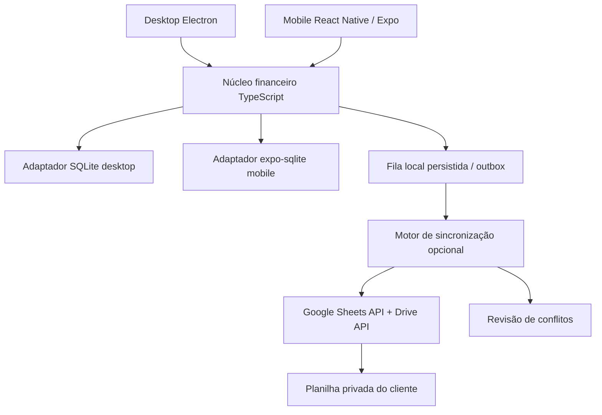

# Plano mobile, operação offline e Google Sheets

Data: 02/11/2026. Base revisada: Contabily 2.0.1. Este documento é planejamento, não funcionalidade implementada.

## Decisão proposta

Adotar **React Native + Expo para Android e iPhone**, conforme preferência do proprietário, com **SQLite local e funcionamento offline**. Primeiro entregável instalável: APK Android. Preparar iOS desde o início e testar em iPhone quando houver o caminho de assinatura/dispositivo definido. Google Sheets será integração **opcional**, na conta do cliente, sem servidor próprio do Contabily nesta fase.

Não mudar o desktop para exigir Google. Não converter o renderer Electron diretamente para React Native. Não usar planilha como substituto de transações financeiras locais. Corrigir antes os bloqueadores da [revisão](REVISAO-COMPLETA-2026-11-02.md).

## O que cada modo oferece

| Modo                                                 | Onde opera                                                   | Internet/conta                                      | Garantias e limites                                                                                                                                                   |
| ---------------------------------------------------- | ------------------------------------------------------------ | --------------------------------------------------- | --------------------------------------------------------------------------------------------------------------------------------------------------------------------- |
| Somente neste dispositivo                            | SQLite local                                                 | Não exige Google                                    | Cadastro e relatórios offline; usuário cuida do backup. Sem sincronização.                                                                                            |
| Planilha como cópia e consulta — primeira integração | SQLite local; publicação em planilha escolhida               | Conta Google e consentimento                        | Atualização unidirecional de um dispositivo principal. Não importa automaticamente edições da planilha nem mescla bancos.                                             |
| Sincronizar com minha planilha — beta posterior      | SQLite em cada dispositivo; registro compartilhado no Sheets | Conta Google, permissões e rede para enviar/receber | Fila offline, idempotência e conflitos explícitos. Mesma pessoa em desktop/celular inicialmente; edição simultânea financeira depende do aceite da prova de conceito. |
| Família compartilhada                                | Livro familiar e usuários autorizados                        | Contas/permissões Google distintas                  | Adiar até validar conflitos e definir confiança entre participantes. Editor de planilha tem acesso ao arquivo inteiro. Não oferece controle forte por linha/pessoa.   |
| Servidor próprio/gerenciado — futuro                 | Banco central transacional e API                             | Infraestrutura adicional                            | Alternativa se surgirem necessidade de permissões fortes, integridade central, alta concorrência ou push. Fora da primeira entrega.                                   |

“Online” será uma opção de sincronização, não uma dependência para salvar cada lançamento. Se a rede cair, gravação local e fila continuam. Distinguir “salvo neste aparelho” de “enviado à planilha”. Cópia unidirecional não pode ser chamada de sincronização bidirecional.

## Arquitetura proposta



O desenho representa portas/implementações: cada aplicativo usa seu próprio SQLite; não há um arquivo SQLite aberto ao mesmo tempo por vários dispositivos. Não copiar o `.db` vivo para uma pasta sincronizada.

Estrutura alvo incremental, sem mover todo o projeto na primeira tarefa:

```text
packages/domain       dinheiro, calendário, estados, invariantes e projeções puras
packages/application  casos de uso, portas de persistência e autorização por livro
packages/contracts    DTOs de centavos/datas/UUID, versões e validação em runtime
packages/sync         outbox, eventos, conflitos e protocolo; sem UI/Node
apps/desktop          Electron, bridge IPC, React web e adaptadores existentes
apps/mobile           React Native, Expo e adaptadores nativos
```

Começar extraindo `src/shared/finance` e a validação financeira; retirar dependência do relógio global quando afeta competência/liquidação. Criar uma porta `FinanceApplication` em torno das chamadas do renderer. Depois mover o restante conforme os fluxos forem cobertos. O desktop pode manter TypeORM/better-sqlite3 enquanto o mobile usa `expo-sqlite`; ambos obedecem aos mesmos contratos e migrações compatíveis. Não introduzir outro ORM apenas para uniformizar aparência do código.

O [React Native usa componentes nativos](https://reactnative.dev/docs/intro-react-native-components); logo MUI/DOM, CSS web e tabelas atuais precisam de apresentação nova. A [documentação do React Native recomenda frameworks como Expo](https://reactnative.dev/docs/environment-setup) para projetos novos. Reutilização principal será do domínio, contratos, textos e tokens, não das 18 páginas inteiras.

## Modelo de dados necessário

| Mudança                                   | Motivo/critério                                                                                                                                        |
| ----------------------------------------- | ------------------------------------------------------------------------------------------------------------------------------------------------------ |
| `workspace_id`/livro e `member_id`        | Perfil local não é identidade global nem família. Uma conexão remota sincroniza somente o livro escolhido.                                             |
| UUID estável por entidade e operação      | Dois aparelhos podem ter conta local de ID 1. Preservar IDs locais internamente e adicionar mapeamento global.                                         |
| `amount_cents`, moeda BRL inicial         | Inteiros positivos/validados, com sinal definido pela operação; não sincronizar texto “R$ 1.234,56”. Não usar floats para somar dinheiro.              |
| Datas de calendário e instantes separados | Competência/vencimento/liquidação como YYYY-MM-DD; evento técnico como instante UTC. Não atribuir liquidação com o relógio do aparelho que recebe.     |
| Revisão e dependências de operação        | Detectar edição baseada em versão antiga, sem confiar só em `updated_at` ou no relógio do celular.                                                     |
| Tombstone/exclusão lógica                 | Remoção precisa chegar a aparelhos que ficaram offline. Não apagar remotamente a linha como protocolo normal.                                          |
| Chave semântica para recorrência          | Mesmo livro + regra + ocorrência identificam um único lançamento, mesmo se dois aparelhos o gerarem.                                                   |
| Origem financeira explícita               | Entrada/saída, transferência, compra de cartão, pagamento de fatura, investimento e ajuste não podem ser somados como a mesma coisa.                   |
| Campos derivados separados                | Saldo, total de fatura, progresso de meta e indicadores são reconstruídos pelos eventos válidos. Nunca sincronizar incrementos independentes de saldo. |

Migração futura deve ser versionada e preservar os dados 2.x, com backup, teste de rollback e mapa UUID determinável. A autorização antiga para recriar banco no salto 1.x → 2.x não deve virar política de apagar a base a cada evolução.

Backup atual contém todos os perfis e usa APIs Node. Não é o formato de intercâmbio mobile. Definir exportação lógica versionada por livro, com relações, centavos, datas e hash; anexos em arquivos separados. Validar ida e volta desktop → mobile → desktop. Não exportar senha/hash do perfil nem tokens Google.

## Aplicativo mobile e escopo

Navegação proposta: **Início**, **Lançamentos**, **Planejamento**, **Mais**, com ação clara de adicionar receita/despesa. Lista de cartões mostra vencimento e valor; não transportar uma tabela desktop inteira para uma tela pequena. Teclado, área segura, fonte ampliada e leitor de tela entram nos critérios de aceite.

| Entrega                         | Recursos                                                                                                                                                                            |
| ------------------------------- | ----------------------------------------------------------------------------------------------------------------------------------------------------------------------------------- |
| M1 — primeiro APK útil, offline | Conta/livro local, categorias, cadastro e edição de receitas/despesas, competência/liquidação, filtros e resumo mensal; backup/importação lógica por livro. Sem Google obrigatório. |
| M2 — rotina completa            | Transferências, parcelas, cartões/faturas com vencimento configurável, recorrentes, orçamento, metas e avisos locais. Depende dos ajustes de integridade do desktop.                |
| M3 — complementos               | Investimentos, relatórios/exportações, anexos por câmera/arquivos, análises com amostra válida, manual e IR com ano e escopo explícitos.                                            |
| M4 — Google optativo            | Conectar/criar planilha, publicar cópia consultável; leitura mobile da cópia separada do livro editável. Sincronização bidirecional só em entrega posterior aprovada.               |

O primeiro APK não é promessa de paridade de todos os módulos. Cada entrega identifica recursos presentes e pendentes; iOS utiliza os mesmos casos de uso desde M1, com ensaios próprios, não apenas a suposição de que “compila em Android”.

Adaptadores mobile: `expo-sqlite`, armazenamento de credenciais com `expo-secure-store`, picker de documentos/imagens, compartilhamento de arquivos e notificações locais. Avaliar versões exatas e compatibilidade no spike; não fixar dependências neste planejamento. O [SQLite do Expo](https://docs.expo.dev/versions/latest/sdk/sqlite/) oferece persistência nativa; se optar por SQLCipher, exige build próprio e verificação de que a criptografia foi realmente habilitada. Token em SecureStore não criptografa automaticamente o banco inteiro.

Expo Go pode ajudar no protótipo visual; não deve ser o aceite de OAuth/SQLite criptografado/plugins nativos. A [integração Google no Expo](https://docs.expo.dev/guides/google-authentication/) envolve bibliotecas nativas e development build. Não confundir login Google com permissão para ler/gravar a planilha.

## Google Sheets sem servidor próprio

O cliente conecta sua conta Google e cria uma planilha pelo Contabily ou seleciona um arquivo compatível. O desenvolvedor mantém um projeto no Google Cloud com Sheets/Drive APIs e credenciais OAuth por plataforma. Projeto Cloud não significa contratar uma VM/servidor.

Usar autorização no navegador externo/SDK nativo adequado, com state e PKCE quando aplicável. Desktop usa fluxo de aplicativo instalado; Android/iOS usam seus fluxos nativos e identidade de pacote/assinatura. Nunca colocar chave privada de service account ou segredo de servidor no APK. OAuth client ID é configuração pública, não substitui o consentimento. Tokens ficam no armazenamento protegido de cada plataforma e não vão para planilha, logs ou backup de negócio.

Preferir escopo `drive.file` para arquivos criados/selecionados pela aplicação, validando-o no fluxo real. O [Google documenta esse escopo](https://developers.google.com/workspace/drive/api/guides/api-specific-auth) e a [API Sheets o aceita](https://developers.google.com/workspace/sheets/api/scopes). Um link colado não garante acesso com esse escopo; a prova de conceito deve testar abrir no iPhone/Android um arquivo criado no desktop e o consentimento de outro participante. Não ampliar silenciosamente para acesso ao Drive inteiro. Se o picker/fluxo exigir outra configuração, documentar a alternativa e suas permissões antes do uso real.

Consentimento em modo Testing não é adequado como solução permanente: [refresh tokens podem expirar em sete dias](https://developers.google.com/identity/protocols/oauth2#expiration). Antes de distribuir, conferir publicação do OAuth, exigências de verificação, política de privacidade e como revogar acesso. Não prometer sincronização permanente porque o primeiro login funcionou.

### Estrutura da planilha

| Aba                                             | Conteúdo                                                               | Edição                                                                                       |
| ----------------------------------------------- | ---------------------------------------------------------------------- | -------------------------------------------------------------------------------------------- |
| `Sobre`                                         | Identidade Contabily, versão, livro, aviso de privacidade e instruções | Pelo app; nome pode ser amigável.                                                            |
| `_manifest`                                     | UUID do livro, versão de protocolo, época/snapshot e configuração      | Técnica, validada; proteção reduz acidentes, não é barreira contra proprietário/editor.      |
| `_operations`                                   | Na fase bidirecional: eventos completos, imutáveis e identificados     | Append pelo app; não ordenar/editar/apagar manualmente como operação de negócio.             |
| `Contas`, `Categorias`, `Lancamentos`           | Visões legíveis do estado confirmado                                   | Derivadas; a primeira versão publica a partir do dispositivo principal.                      |
| `Orcamento`, `Metas`, `Investimentos`, `Resumo` | Visões dos módulos habilitados e data de atualização                   | Consulta; sem depender de fórmulas para invariantes financeiras.                             |
| `Entrada_manual` — futura                       | Linhas de rascunho com status de validação                             | Usuário pode preencher; app importa após revisão. Não altera diretamente o registro técnico. |

Não aceitar planilha arbitrária como banco na primeira versão. Identificar por spreadsheet ID, UUID do livro e manifest, não pelo nome ou posição da aba. Usar sheet IDs estáveis. Renomear, reordenar, remover colunas ou quebrar a estrutura técnica deve produzir diagnóstico, não sobrescrita automática.

Valores via API com `RAW` preservam textos como texto; `USER_ENTERED` permite interpretação de fórmulas/datas. Essa distinção está na [documentação do Google](https://developers.google.com/workspace/sheets/api/reference/rest/v4/ValueInputOption). Descrição nunca vira fórmula executável por conveniência. Fotos/PDFs e arquivos SQLite não cabem como registros tabulares: manter locais primeiro; upload ao Drive como recurso separado e explicitamente consentido depois.

Planilha legível não oferece criptografia ponta a ponta. Quem possui acesso ao arquivo pode ver o conteúdo autorizado. Se futuramente for exigida criptografia cujo segredo só o usuário conhece, o transporte teria payload cifrado e perderia a consulta/edição comum no Sheets; isso é outro modo de produto, não uma propriedade automática deste plano.

### Protocolo bidirecional proposto — sujeito ao spike

Cada operação possui `operation_id`, `workspace_id`, `device_id`, `actor_ref`, `entity_uuid`, `base_revision`, `protocol_version`, `occurred_at`, `payload_json` e referências às dependências. Uma operação lógica contém todas as alterações correlatas ou um comando determinístico versionado: transferência não pode chegar como duas metades independentes. A identidade de ator é informativa enquanto o editor pode modificar a própria planilha; não é trilha antifraude garantida.

1. Validar comando, persistir efeito local e outbox na mesma transação SQLite.
2. Ao sincronizar, ler manifest e novas operações, validar versão, dependências e livro, aplicar em transação local ou colocar em quarentena/conflito.
3. Enviar operações pendentes em lotes pequenos, preservando operation_id em toda tentativa. Não editar uma linha de saldo remoto.
4. Se a resposta se perder, consultar se a operação já chegou antes de reenviar. Duplicatas físicas podem ocorrer; o materializador deduplica por ID. A API não fornece a unicidade de domínio do aplicativo.
5. Só marcar enviado após confirmar presença; estados locais distinguem aguardando rede, enviado, erro e conflito.
6. Atualizar as abas de consulta apenas a partir do estado materializado consistente. Edição concorrente de uma entidade não é resolvida apenas com “último horário vence”. Preservar alternativas e pedir resolução explícita; a resolução é outra operação que referencia as versões em conflito.

O [append do Sheets](https://developers.google.com/workspace/sheets/api/reference/rest/v4/spreadsheets.values/append) acrescenta dados à tabela identificada pelo intervalo. Não tratar número da linha ou ordem de chegada como relógio global, revisão garantida ou ID de negócio. Leituras periódicas devem detectar reordenação/remoção; usar sobreposição/deduplicação e verificações de integridade, com varredura completa periódica. Não avançar um cursor além de falha não reconciliada.

Atomicidade de uma requisição/lote **não equivale** a compare-and-swap entre aparelhos. Ler revisão 5 e depois escrever revisão 6 não é bloqueio. Dois aparelhos podem pagar a mesma fatura ou editar a mesma conta offline antes de ver o outro. Chaves semânticas e DAG de revisões ajudam a detectar/reconciliar, mas não impedem toda decisão concorrente. A primeira beta deve restringir operações sensíveis a um dispositivo principal ou deixá-las pendentes de revisão; só ampliar com prova de invariantes. Um campo “lock” na planilha, escrito após leitura, não resolve sozinho esse problema.

Conflitos obrigatórios: edição/edição, edição/exclusão, pagamento de fatura duplicado, geração de mesma recorrência, alteração de conta/categoria referenciada, ajuste de saldo concorrente e importação repetida em dois aparelhos. Não somar saldos divergentes nem duplicar contribuições como estratégia de mescla.

Não compactar/excluir eventos enquanto aparelhos antigos podem reenviá-los. Se a base crescer, usar snapshot com hash, época e protocolo de reentrada para aparelho atrasado; restaurar backup deve criar processo de recuperação explícito para não ressuscitar exclusões nem repetir movimentos. Hash detecta corrupção acidental; não prova autenticidade contra editor do arquivo.

### Limites operacionais e uso offline

As [cotas documentadas](https://developers.google.com/workspace/sheets/api/limits) são, por minuto, 300 leituras e 300 escritas por projeto, com 60 de cada por usuário/projeto. O Google recomenda payload até 2 MB e backoff em erros de cota. O limite de projeto é compartilhado por clientes do mesmo aplicativo; não assumir uma cota de projeto inteira por família.

Metas internas do piloto, a validar: lotes de até 50 operações ou 128 KiB; payload individual até 16 KiB; sem binários; sincronizar ao abrir/voltar ao app, salvar com debounce e por comando manual. São escolhas de projeto, não limites oficiais do Google. Pausar em 401/403 e pedir reconexão/permissão; em 429 usar backoff com jitter; em indisponibilidade preservar fila. Não garantir background contínuo em Android/iOS nem notificação push sem infraestrutura.

Após revogar acesso, parar envio e não apagar a cópia local. Revogação não remove cópias já recebidas por outro aparelho/editor. Apagar remotamente ou publicar por link são ações separadas que não podem ocorrer ao clicar apenas em “desconectar”. Nunca compartilhar publicamente por padrão.

## Custos e distribuição

Valores e condições consultados em fontes oficiais em 02/11/2026; preços, cotas, impostos e conversão para reais podem mudar. Não foi contratado serviço pago nesta revisão. Custo de implementação, equipamentos, internet e manutenção existe mesmo quando não há mensalidade de hospedagem.

| Item                              | Primeiro momento                                                                    | Quando pode custar                                                                                                                                                                                                                 |
| --------------------------------- | ----------------------------------------------------------------------------------- | ---------------------------------------------------------------------------------------------------------------------------------------------------------------------------------------------------------------------------------- |
| React Native/Expo SDK             | Sem licença mensal para construir o app                                             | Desenvolvimento/manutenção e eventuais bibliotecas/serviços escolhidos.                                                                                                                                                            |
| APK Android pessoal               | Pode ser gerado sem publicar na Play Store                                          | Registro/verificação conforme canal e regras vigentes; assinatura/keystore deve ser preservada para atualizar o mesmo app.                                                                                                         |
| EAS Build                         | Plano Free consultado: 15 builds Android + 15 iOS, fila de baixa prioridade         | Assinatura/uso pago se precisar de capacidade extra. Não é obrigatório contratar o Starter.                                                                                                                                        |
| Build local Android               | Possível com Android Studio/JDK em máquina compatível, inclusive Windows            | Hardware/tempo/configuração; não consome cota EAS quando não usa o serviço.                                                                                                                                                        |
| iPhone independente               | Não instala APK. Testes visuais no Expo Go não equivalem ao app distribuído         | Apple Developer Program: US$ 99 por ano, preço regional no cadastro, para distribuição usual/TestFlight/ad hoc. EAS não elimina a exigência da Apple.                                                                              |
| iPhone em teste pessoal via Xcode | Conta gratuita permite testes limitados, com Mac/Xcode                              | Provisionamento gratuito expira em sete dias e exige reinstalação; não é distribuição permanente para cliente. Sem Mac, considerar build em nuvem e as credenciais necessárias.                                                    |
| Sheets/Drive APIs                 | Uso padrão do Sheets documentado sem cobrança adicional, dentro das condições/cotas | Revalidar política de excedentes e cobrança no console; documentação menciona evolução de cobrança para excedentes em 2026. Espaço de armazenamento Google também pode exigir plano do usuário. Não prometer gratuidade ilimitada. |
| Servidor Contabily                | Nenhum nesta proposta inicial                                                       | Apenas se adotado posteriormente; custo de hospedagem/banco/operador será outro orçamento.                                                                                                                                         |

Fontes de custos: [Expo Pricing](https://expo.dev/pricing), [build APK](https://docs.expo.dev/build-reference/apk/), [distribuição interna Expo](https://docs.expo.dev/build/internal-distribution/), [Apple Developer Program](https://developer.apple.com/programs/enroll/), [Personal Team/Xcode](https://developer.apple.com/help/account/basics/about-your-developer-account), [Sheets Limits](https://developers.google.com/workspace/sheets/api/limits).

No Brasil, não presumir que distribuir qualquer APK por link dispensa regras da plataforma. A [documentação Android de distribuição limitada](https://developer.android.com/developer-verification/guides/limited-distribution), atualizada em 28/10/2026, descreve conta gratuita para uso pessoal/hobby e registro/autorização de dispositivos. O texto consultado informa até 50 dispositivos; um resultado de busca ainda mostrava 20, então confirmar o limite no console ao cadastrar. A entrega inicial deve validar o caminho permitido no aparelho real do proprietário, sem prometer distribuição pública irrestrita ou sugerir contornar controles.

Conclusão de custo: o piloto Android pessoal pode começar sem mensalidade de servidor e sem plano pago Expo. iPhone deve ter orçamento/rota de testes própria; distribuição convencional acrescenta a conta Apple. Sheets reduz infraestrutura administrada, mas não elimina trabalho de sincronização, limites ou manutenção.

## Fases, entregáveis e critérios de aceite

Estimativas de esforço para um desenvolvedor familiarizado com a base, não prazo contratado. Dias úteis de engenharia; não incluem espera por contas, verificação Google/Apple, revisão de loja, aquisição de equipamento ou mudanças de escopo. Reestimar após cada prova de conceito.

| Fase                       | Esforço indicativo    | Entregáveis e aceite                                                                                                                                                                                  |
| -------------------------- | --------------------- | ----------------------------------------------------------------------------------------------------------------------------------------------------------------------------------------------------- |
| F0 — integridade           | 7–12 dias             | Corrigir R01–R05, regressões negativas/concorrência; plano para R06–R10. Nenhum teste de propriedade/caixa/fatura crítico pendente antes de sync.                                                     |
| F1 — núcleo portátil       | 5–8 dias              | Casos de uso puros, DTOs cents/datas, autorização, portas de banco, UUID e migração preservando 2.x. Desktop segue funcionando.                                                                       |
| F2 — spike nativo e Google | 4–6 dias              | App RN/Expo em Android e iOS; SQLite persistente; protótipo OAuth e criação/leitura de planilha fictícia entre plataformas. Identificar custos/permissões reais. APK de teste não usa dados pessoais. |
| F3 — M1 offline            | 10–15 dias            | Primeiro APK útil, cadastro/edição/liquidação, categorias/contas, lista, resumo e intercâmbio por livro; ensaios no iPhone também, pelo caminho disponível.                                           |
| F4 — rotina e cópia Sheets | 8–12 dias             | Recursos M2 priorizados; conexão optativa, planilha legível, publicação unidirecional e leitura de consulta. Sem alegar mescla bidirecional.                                                          |
| F5 — sync beta             | 12–20 dias            | Protocolo/outbox, conflitos, reconexão, migração, recovery e testes de queda/repetição. Mesmo usuário, restrições de operação sensível explícitas. Só liberar se invariantes passarem.                |
| F6 — paridade e família    | 10–20 dias, reestimar | M3, anexos, permissões familiares compatíveis com confiança do arquivo e homologação real. Servidor fica como alternativa caso Sheets não satisfaça os critérios.                                     |

Ordem sugerida pode paralelizar apenas protótipos sem dados reais, não pular bloqueadores. Núcleo + primeiro APK: aproximadamente 26–41 dias de engenharia incluindo F0–F3; cópia Sheets e rotina acrescentam F4; sync robusta e paridade são entregas separadas. Esses intervalos não representam valor financeiro nem compromisso de calendário.

### Primeira prova de conceito a construir

Um livro fictício, uma conta, salário e despesa. Criar no desktop, exportar logicamente, abrir no mobile e conferir centavos/datas. No Android e iPhone, autorizar Google, criar/selecionar planilha com escopo mínimo, ler o mesmo manifest e publicar texto que começa com `=` como texto. Interromper a rede depois do envio e antes da resposta; demonstrar recuperação sem duplicar. Comparar os estados após duas edições offline e medir o que a API realmente garante. Se isso falhar, manter cópia/consulta e não anunciar sync.

### Matriz mínima de homologação

- Mobile: teclado cobrindo campo, rotação, fonte grande, leitor de tela, reinício/morte do processo, pouca memória, reinstalação e migração do banco; permissões de arquivo/câmera/notificação negadas.
- Finanças: centavos, datas bissextas/fusos, competência distinta da liquidação, estorno/cancelamento, conta/cartão corretos, contribuições simultâneas, transferências indivisíveis e ajuste de saldo recuperável.
- Rede: queda antes/depois da gravação, reenvio dez vezes da mesma operação, 401/403/429/5xx, token revogado, conta Google trocada e fila longa offline.
- Planilha: aba renomeada, coluna removida, edição manual, fórmula inserida, arquivo apagado/restaurado, permissão alterada e protocolo de versão mais nova.
- Concorrência: dois aparelhos gerando recorrência, pagando fatura, editando/excluindo mesma transação e importando o mesmo extrato. Sem vencedor silencioso para conflito financeiro.
- Recuperação: novo aparelho, backup anterior à última sincronização, tombstones, IDs preservados e prova de que não há duplicação após restaurar.
- Distribuição: atualizar APK anterior com mesma assinatura sem perder banco; caminho de instalação no Android do proprietário; fluxo nativo iOS real antes de declarar iPhone disponível.

## Quando reconsiderar servidor

Não planejar servidor apenas por conveniência técnica. Reconsiderar se o piloto exigir permissões por membro/registro que editores da planilha não possam burlar, transação central com unicidade forte, muitos clientes simultâneos, auditoria resistente a alteração, push central ou atendimento com recuperação administrada. Nesse ponto pode ser uma API pequena com Postgres/serviço gerenciado e o mesmo núcleo/protocolo, preservando modo local e exportação. Apps Script com endpoint/locks também é backend hospedado e traz operação/quotas/autorização; não tratá-lo como “nenhum servidor” nem colocá-lo escondido nesta proposta.

## Decisões já registradas e pendências

Registrado pelo proprietário: Android **e** iPhone, preferência por React Native, primeiro uso via APK, preferência por Google Sheets em vez de servidor próprio. Arquitetura proposta: Expo + SQLite offline e Google optativo.

Pendências para implementação, sem impedir este planejamento: aparelho Android/versão para instalação; acesso a iPhone e Mac ou conta Apple; conta/projeto OAuth do proprietário; planilha legível versus transporte cifrado; necessidade real de colaboração entre contas diferentes; orçamento de esforço e quais módulos entram no primeiro APK. Não criar contas, contratar planos ou enviar dados pessoais apenas para completar a revisão.
